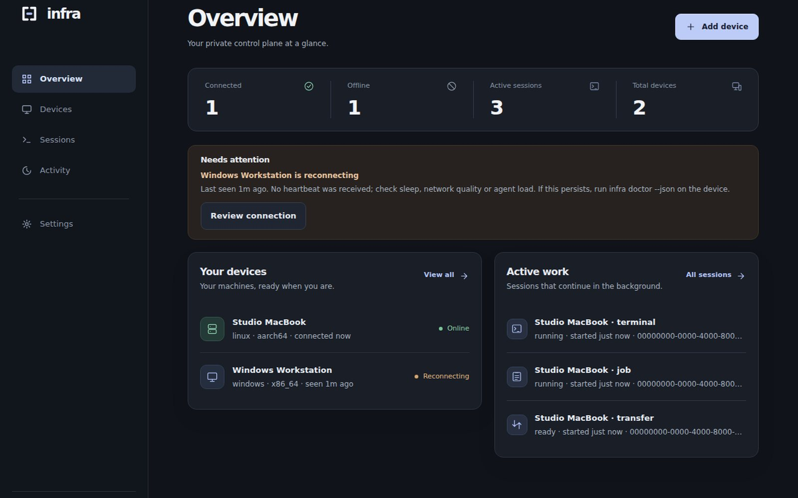
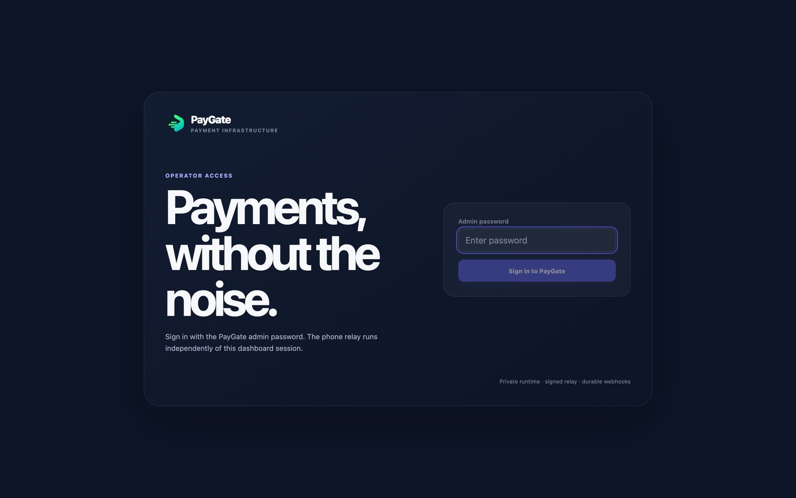
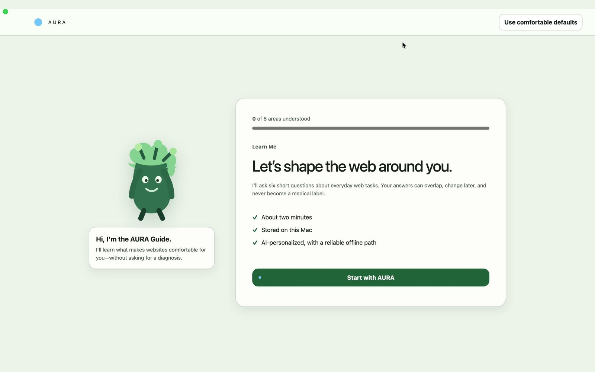
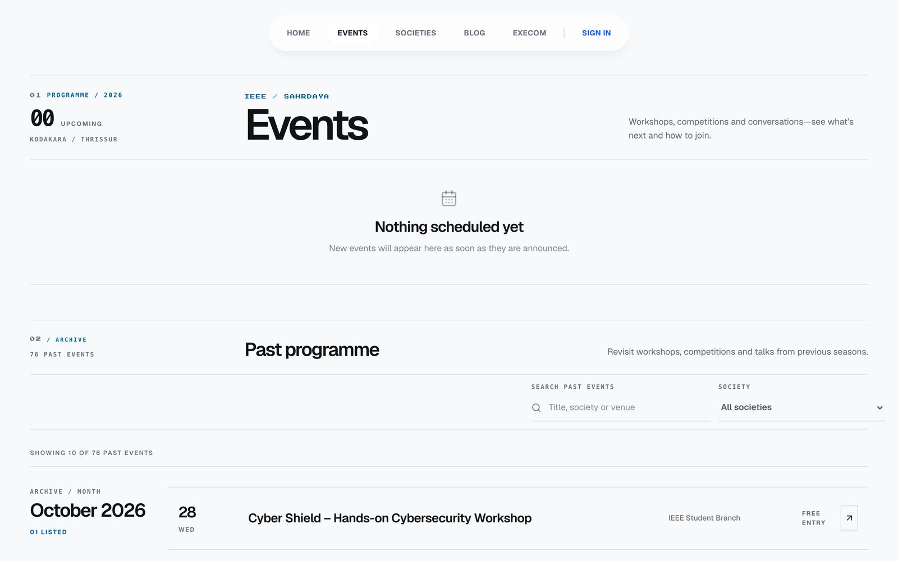

# Sourav P Bijoy

I build payment infrastructure, event platforms, and the tooling that keeps them running.
Final-year computer science student at Sahrdaya College of Engineering and Technology, Kerala.

<a href="mailto:souravpbijoy@gmail.com">email</a> · <a href="https://linkedin.com/in/SouravPBijoy">linkedin</a> · <a href="https://ieeesahrdaya.com">ieee sahrdaya</a> · <a href="https://mulearnscet.in">mulearn scet</a>

> **Now** — taking `infra-mcp` from release candidate to v1, and maintaining the IEEE Sahrdaya platform.

<table>
<tr>
<td width="50%"> <b>infra-mcp</b> — Rust control plane for AI clients</td>
<td width="50%"> <b>PayGate</b> — self-hosted UPI verification</td>
</tr>
<tr>
<td width="50%"> <b>AURA</b> — accessibility browser for macOS</td>
<td width="50%"> <b>IEEE Sahrdaya</b> — event platform for 13 societies</td>
</tr>
</table>

## Selected work

**[infra-mcp](https://github.com/Phloraxx/infra-mcp)** — a private control plane for your own machines. One Rust gateway, signed native agents on macOS, Windows, Linux and Android, an embedded dashboard, and MCP tools whose terminals, jobs and file transfers survive a dropped connection.

`Rust` · `axum` · `MCP` · `MIT` · [releases](https://github.com/Phloraxx/infra-mcp/releases)

**[PayGate](https://github.com/Phloraxx/payment-api)** — self-hosted UPI verification. Every payment gets a unique payable amount; notifications arrive through independently revocable Android relays; a payment only changes state when the server holds evidence it can attribute to a real origin. No funds pass through it.

`Go` · `SQLite` · `Android` · `AGPL-3.0` · [live](https://pay.mulearnscet.in)

**[AURA](https://github.com/Phloraxx/AURA)** — an accessibility browser that learns how one person uses the web, reads the page in front of them, and recomposes it around their needs. Reversible, and without asking for a diagnosis first.

`Electron` · `React` · `TypeScript` · [v0.1.0](https://github.com/Phloraxx/AURA/releases/latest)

**[IEEE Sahrdaya](https://ieeesahrdaya.com)** — the platform behind 13 IEEE societies: registrations, QR check-in, UPI verification, certificates and receipts. A registration is a transaction; if any step fails, no seat is reserved.

`React Router` · `PocketBase` · `TypeScript` · [source](https://github.com/Phloraxx/IEEE-sahrdayaCET)

## Also built

- **[MCflare](https://github.com/Phloraxx/mcflare)** — puts a Minecraft Java server behind Cloudflare without asking players to install a tunnel, VPN or launcher. Fabric, Quilt, NeoForge and Paper builds.
- **[ReFlow](https://github.com/Phloraxx/reflow)** — evidence-first settlement reconciliation. Compiles merchant, gateway and bank records into a money graph, then emits a machine-verifiable proof. 317/317 correct on a 500-settlement adversarial workload.
- **[VisionHack portal](https://portal.mulearn.org)** — hackathon submissions across a four-level invite chain, with JWT sessions, rate limiting and CSV export. [Source](https://github.com/Phloraxx/VisionHack_Submission-Portal)
- **[µLearn SCET](https://mulearnscet.in)** — campus site with karma-based tasks, peer review and leaderboards. [Source](https://github.com/Phloraxx/MuLearn-Scet-Webpage)
- **[CodeResidency](https://github.com/Phloraxx/CodeResidency)** — clinical rotation simulator for CS students, five phases on LangChain and Gemini with Docker-sandboxed execution.
- **[AgentX](https://github.com/Phloraxx/AgentX)** — a Write → Sabotage → Fix debugging trainer run by three LLM agents.

## Stack

- **Languages** — TypeScript, Python, Rust, Go, Java, Kotlin, Swift
- **Frontend** — React, React Router, Next.js, Tailwind, Vite
- **Backend** — FastAPI, Flask, axum, SQLite, PostgreSQL
- **Platform** — Docker, Cloudflare Workers, GitHub Actions, PocketBase, Appwrite
- **AI** — LangGraph, LangChain, local models via Ollama

---

Open to internships and full-time roles — <a href="mailto:souravpbijoy@gmail.com">souravpbijoy@gmail.com</a>
